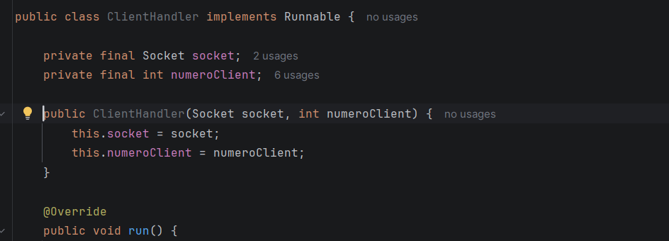
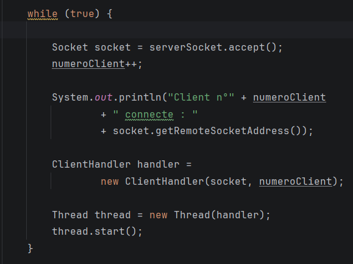
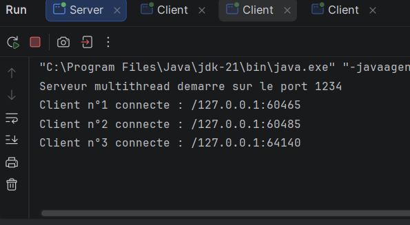
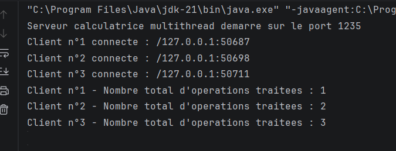

# TP3 – Développement d'Applications Réparties
## Activité 3-1 : Serveur Multi-threads – Sockets TCP

### Objectif
L'objectif de cette activité est de développer un serveur TCP multithread capable de gérer plusieurs clients simultanément, en utilisant les sockets Java et les threads.

### Environnement de travail
- Java JDK 21
- IntelliJ IDEA
- Sockets TCP
- Threads Java
- Git et GitHub

### 1. Implémentation du ClientHandler

La classe `ClientHandler` implémente l'interface `Runnable` afin de traiter chaque client dans un thread indépendant.

Chaque client peut envoyer des opérations mathématiques au serveur et recevoir les résultats correspondants.

### 2. Implémentation du serveur multithread

La classe `Server` utilise `ServerSocket` pour accepter les connexions TCP sur le port `1234`.

Pour chaque nouvelle connexion, le serveur :
- Attribue un numéro au client.
- Affiche son adresse réseau et son ordre de connexion.
- Crée un thread indépendant pour traiter ses requêtes.

### 3. Tests des connexions simultanées

Le serveur a été testé localement avec trois clients Java connectés simultanément.

Chaque client reçoit son numéro de connexion et peut communiquer avec le serveur indépendamment des autres clients.

### Synthèse

Cette activité a permis de mettre en pratique la programmation réseau multithread en Java.

L'utilisation de `ServerSocket`, `Socket`, `Runnable` et `Thread` permet de gérer plusieurs connexions simultanées tout en assurant un traitement indépendant pour chaque client.

Le serveur affiche les informations de connexion et attribue un numéro unique à chaque client.

---

# Activité 3-2 : Calculatrice multithread avec communication par objets

## 1. Objectif

L'objectif de cette activité est de développer une application client-serveur permettant à plusieurs clients d'effectuer des opérations arithmétiques simultanément.

La communication entre le client et le serveur utilise les flux d'objets Java (`ObjectInputStream` et `ObjectOutputStream`).

Le serveur utilise plusieurs threads pour traiter les demandes des clients et un compteur global synchronisé pour suivre le nombre total d'opérations effectuées.

## 2. Structure de l'application

Le package `activite3_2` contient quatre classes :

- `Operation.java` : représente une opération arithmétique sous forme d'objet sérialisable.
- `Client.java` : permet au client de saisir une opération et d'envoyer l'objet au serveur.
- `Server.java` : accepte les connexions des clients et crée un thread pour chaque connexion.
- `ClientProcess.java` : traite les opérations reçues, retourne les résultats et met à jour le compteur global.

## 3. Fonctionnement

1. Le serveur démarre sur le port `1235`.
2. Plusieurs clients peuvent se connecter simultanément.
3. Chaque client reçoit un numéro de connexion.
4. Le client envoie un objet `Operation` contenant deux nombres et un opérateur.
5. Le serveur effectue le calcul et retourne le résultat.
6. Après chaque opération traitée, le compteur global est incrémenté.
7. La méthode `synchronized` garantit un accès sécurisé au compteur partagé.

## 4. Tests réalisés

Les tests ont été effectués localement avec trois clients connectés simultanément.

| Client | Opération | Résultat |
|--------|-----------|----------|
| Client n°1 | 25 * 55 | 1375.0 |
| Client n°2 | 100 + 50 | 150.0 |
| Client n°3 | 200 / 4 | 50.0 |

Le serveur a affiché l'évolution du compteur global de 1 à 3 après le traitement des trois opérations.

## 5. Capture d'écran

### Compteur global synchronisé

## 6. Synthèse

Cette activité a permis de mettre en œuvre une calculatrice distribuée utilisant la communication par objets Java et le multithreading.

Chaque client est traité indépendamment par un thread, ce qui permet de gérer plusieurs connexions simultanées.

L'utilisation d'une méthode `synchronized` permet de protéger le compteur global partagé et d'éviter les problèmes d'accès concurrent.

Les tests locaux ont permis de vérifier le fonctionnement des calculs et du compteur synchronisé.
